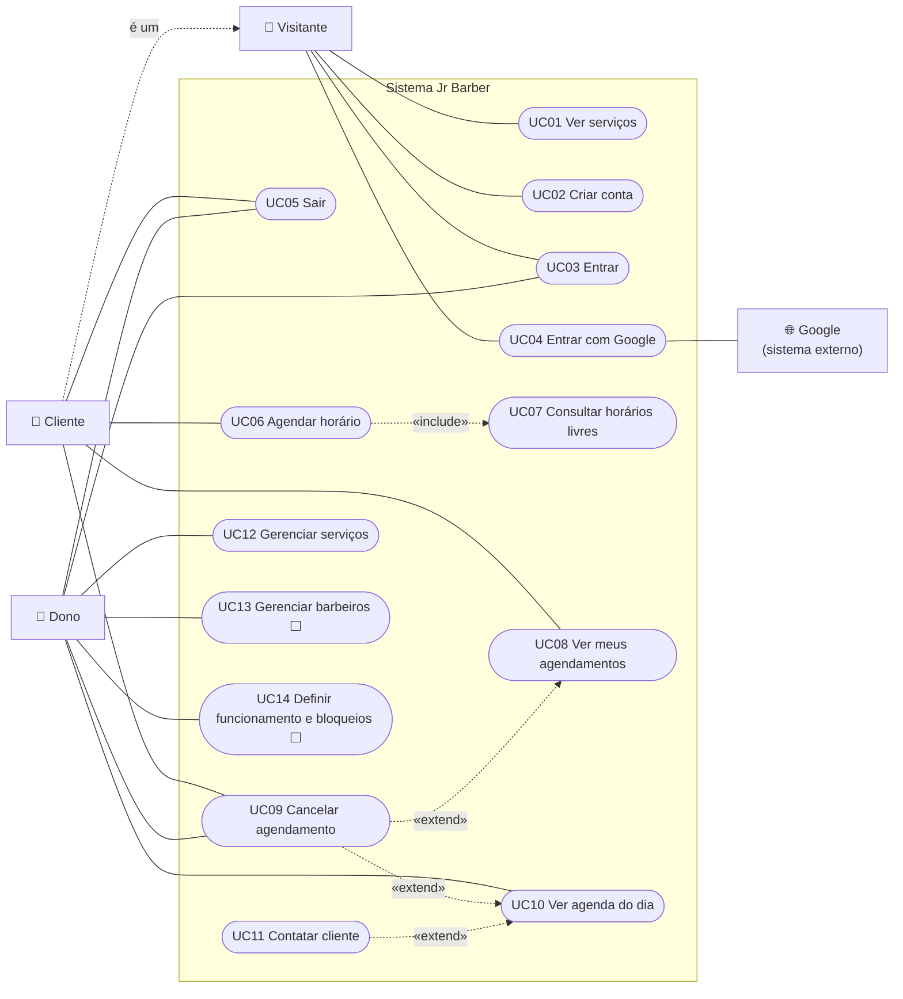

# Diagrama de Casos de Uso

O Mermaid não tem um tipo próprio para casos de uso, então o diagrama usa a
notação de fluxograma: **atores** são retângulos, **casos de uso** são elipses e
a moldura é o limite do sistema. As linhas tracejadas indicam `<<include>>` e
`<<extend>>`.

⬜ = planejado, ainda não implementado.

## Descrição dos casos de uso

| Caso de uso | Ator principal | Requisitos |
| --- | --- | --- |
| UC01 Ver serviços | Visitante | RF07 |
| UC02 Criar conta | Visitante | RF01 |
| UC03 Entrar | Visitante, Dono | RF02, RF04 |
| UC04 Entrar com Google | Visitante (com o Google) | RF03 |
| UC05 Sair | Cliente, Dono | RF05 |
| UC06 Agendar horário | Cliente | RF08, RF11, RF12, RF13 |
| UC07 Consultar horários livres | Cliente (incluído no UC06) | RF09, RF10 |
| UC08 Ver meus agendamentos | Cliente | RF14 |
| UC09 Cancelar agendamento | Cliente, Dono | RF15, RF19 |
| UC10 Ver agenda do dia | Dono | RF16, RF17 |
| UC11 Contatar cliente | Dono | RF18 |
| UC12 Gerenciar serviços | Dono | RF20 |
| UC13 Gerenciar barbeiros | Dono | RF21 |
| UC14 Definir funcionamento e bloqueios | Dono | RF22, RF23 |

## UC06 — Agendar horário (detalhado)

| Item | Descrição |
| --- | --- |
| **Ator** | Cliente |
| **Pré-condição** | Cliente logado (RN01). |
| **Pós-condição** | Agendamento gravado como *confirmado*, com barbeiro definido e código `JR-XXXXXX`. |

**Fluxo principal**

1. O cliente abre "Agendar".
2. O sistema lista os serviços ativos, e o cliente escolhe um.
3. O sistema lista os barbeiros, e o cliente escolhe um ou "Sem preferência".
4. O sistema mostra os dias da janela de 14 dias, marcando os fechados (RN12, RN14).
5. O cliente escolhe o dia, e o sistema mostra os horários livres (UC07; RN13, RN15–RN17).
6. O cliente escolhe o horário.
7. O sistema mostra os dados de contato já preenchidos com os da conta. O cliente confere e, se quiser, altera ou adiciona uma observação (RN22).
8. O cliente confere o resumo e confirma.
9. O sistema confere tudo de novo, define o barbeiro (RN18), grava e mostra a confirmação com o código (RN20).

**Fluxos alternativos**

- **A1, horário ocupado no meio do caminho (passo 9):** outro cliente reservou primeiro (RN19). O sistema avisa "Esse horário acabou de ser ocupado" e o cliente volta ao passo 5.
- **A2, serviço desativado durante o agendamento:** o sistema avisa "Este serviço não está mais disponível".
- **A3, dados inválidos (passo 7):** o sistema marca os campos com erro e não deixa seguir.
- **A4, cliente não logado:** o sistema leva para a tela de login e, depois de entrar, volta ao agendamento.

## UC09 — Cancelar agendamento (detalhado)

| Item | Descrição |
| --- | --- |
| **Atores** | Cliente (próprios agendamentos) ou Dono (qualquer agendamento) |
| **Pré-condição** | Agendamento com status *confirmado*. |
| **Pós-condição** | Status *cancelado*, com registro de quem cancelou, e horário liberado. |

**Fluxo principal**

1. O ator escolhe "Cancelar" em um agendamento.
2. O sistema pede confirmação.
3. O ator confirma.
4. O sistema confere as permissões e o prazo, marca como cancelado e atualiza a lista.

**Fluxos alternativos**

- **A1, cliente fora do prazo:** faltam menos de 2 horas (RN25). O botão não aparece e, se a requisição chegar mesmo assim, o sistema recusa.
- **A2, agendamento de outra pessoa:** o sistema responde "Agendamento não encontrado" (RN24).
- **A3, já cancelado:** o sistema responde "Este agendamento já foi cancelado" (RN27).
