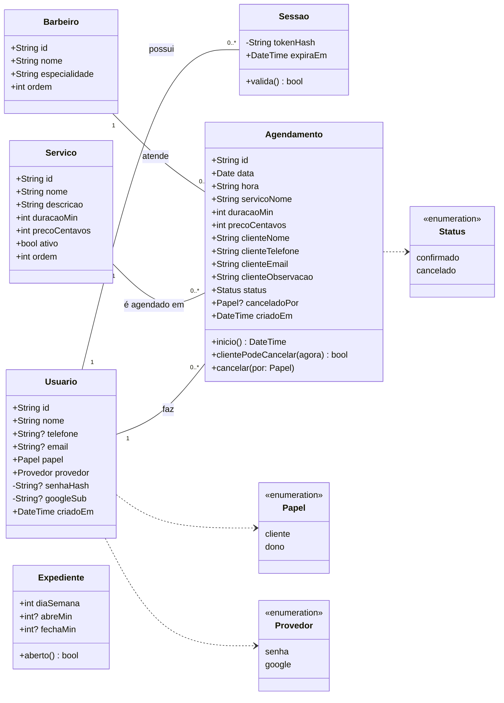

# Diagrama de Classes (domínio)

Classes do domínio como estão no backend (`backend/src/app/models.py`). Os tipos
seguem o banco; `?` indica um campo que pode ficar vazio.

## Observações

- **Agendamento copia dados** do serviço (`servicoNome`, `duracaoMin`, `precoCentavos`) e do contato
  (`cliente*`) no momento da criação (RN21, RN22). Por isso, o histórico não muda se o
  serviço ou a conta forem alterados depois.
- **Expediente** tem 7 registros, um por dia da semana (0 = domingo). Horários
  vazios indicam que a barbearia está fechada naquele dia.
- **Sessao** guarda só o hash do token. O token em si fica apenas no cookie do
  navegador (RNF02).
- Os métodos do diagrama (`inicio`, `clientePodeCancelar`, `aberto`) representam as
  regras de `regras.py`, que no código são funções separadas das classes.
