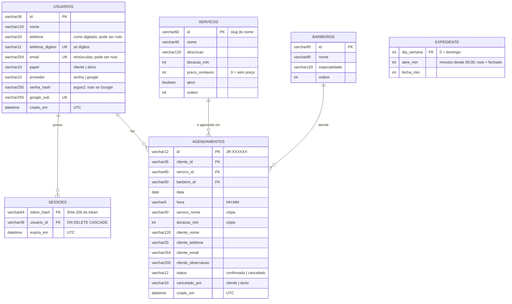

# Diagrama Entidade-Relacionamento

Modelo físico do banco (SQLite no desenvolvimento, PostgreSQL em produção).
As tabelas são criadas pelo backend na primeira execução.

## Índices e restrições

| Tabela | Restrição | Motivo |
| --- | --- | --- |
| `usuarios` | `telefone_digitos` único | Um telefone por conta (RN02) |
| `usuarios` | `email` único | Um e-mail por conta (RN03) |
| `usuarios` | `google_sub` único | Uma conta por usuário Google |
| `agendamentos` | índice `(data, barbeiro_id)` | Agenda do dia e verificação de conflito rápidas |
| `agendamentos` | índice `cliente_id` | "Meus agendamentos" |

`EXPEDIENTE` não tem relacionamento com as outras tabelas: é uma tabela de configuração.
