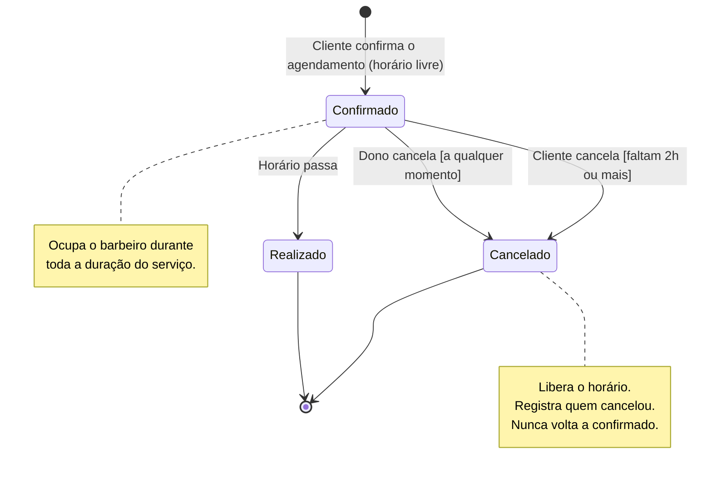

# Diagrama de Estados — Agendamento

## Observação

No banco existem só dois status: `confirmado` e `cancelado`. **Realizado** é um
estado derivado: é um agendamento confirmado cujo horário já passou. É assim que a
tela "Meus agendamentos" separa "Próximos" de "Histórico". Ainda não há registro
de **não comparecimento**, que pode ser um requisito futuro.
